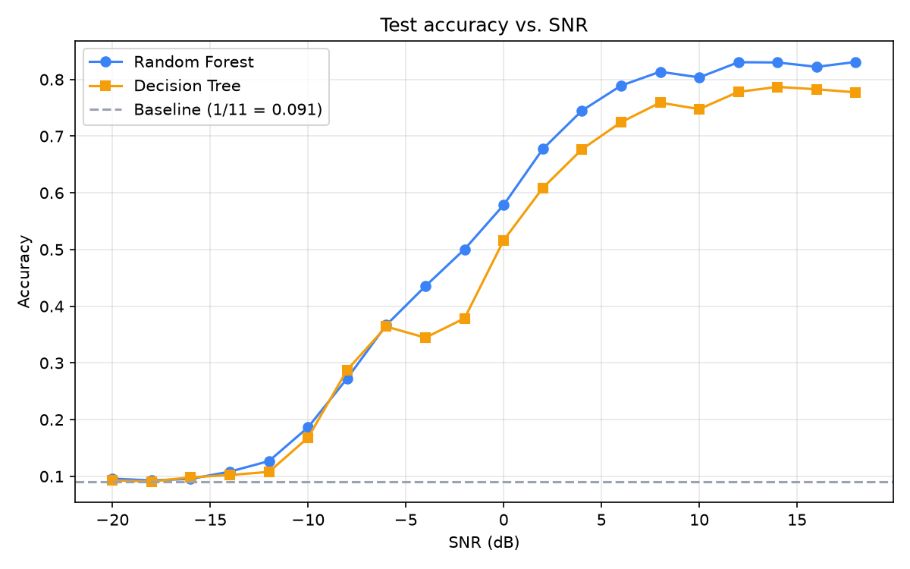
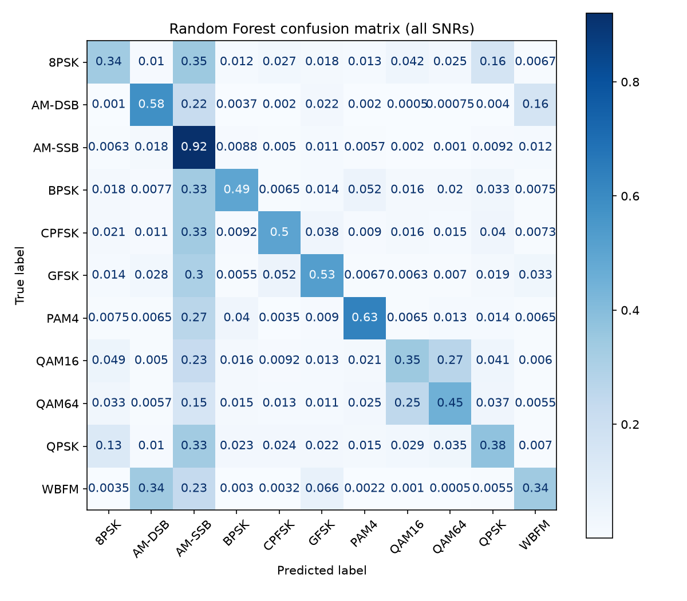
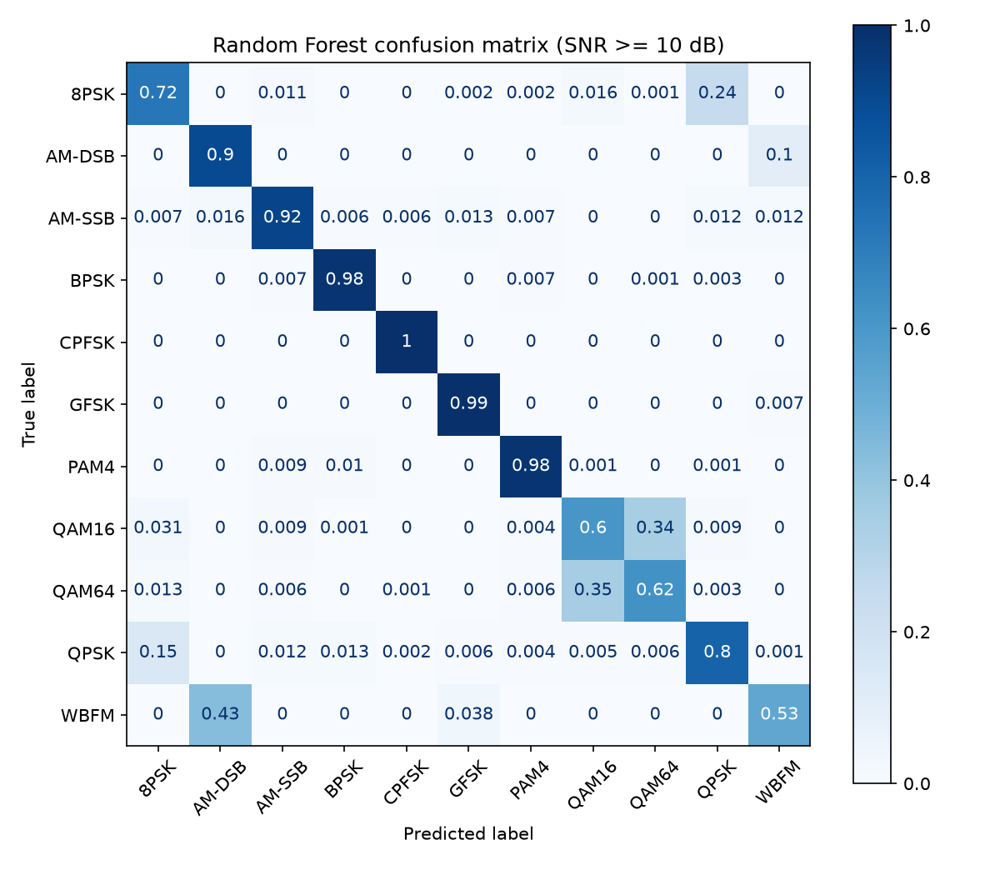

# Radio-Signal-Classifier

A machine learning pipeline that classifies the modulation scheme of a radio signal from its raw I/Q samples.

Python · NumPy · pandas · scikit-learn · FastAPI · pytest

## Results

Cross-validated accuracy (5-fold CV on a 20,000-row stratified tuning sample):

| Model | Mean accuracy | Std | Best params |
| --- | --- | --- | --- |
| Random Forest | 0.476 | 0.004 | `max_depth=20, n_estimators=200` |
| Decision Tree | 0.442 | 0.006 | `max_depth=10` |
| k-NN | 0.418 | 0.003 | `n_neighbors=31` |
| Logistic Regression (L2) | 0.415 | 0.005 | `C=10` |
| Logistic Regression (L1, saga) | 0.415 | 0.004 | `C=100` |
| Baseline (most frequent) | 0.091 | 0.000 | - |

Random Forest was chosen and refit on the full training set. On the held-out test set:

Overall test accuracy: 47.6% (baseline 9.1%), rising to about 83% at SNR ≥ 12 dB.

The test score is higher than the CV score because the final model was trained on the full 176,000-row training set rather than the 20,000-row tuning sample.







## How to run

1. Download `RML2016.10a_dict.pkl` into `data/`.
2. `pip install -r requirements.txt`
3. Build the features (see `notebooks/03_features.ipynb`), producing `data/features.csv`.
4. `python src/train.py`
5. `uvicorn api.main:app --reload`
6. Open http://127.0.0.1:8000/docs

Example request to `POST /classify` (each list needs exactly 128 numbers; shortened here for readability):

```json
{
  "i": [0.0012, -0.0034, 0.0089, ...],
  "q": [-0.0045, 0.0021, -0.0067, ...]
}
```

Example response:

```json
{
  "predictions": [
    {"modulation": "QPSK", "probability": 0.91},
    {"modulation": "8PSK", "probability": 0.05},
    {"modulation": "BPSK", "probability": 0.02}
  ]
}
```

## What I learned

- **Check features before trusting them.** I computed 13 statistical features from
  each signal's amplitude, phase and instantaneous frequency, then found that
  `amplitude_mean` was identical for every signal (about 1/128) because RadioML
  normalizes each one. It carried no information, so I dropped it and kept 12.

- **Noise sets the limit, not the model.** The random forest reached 47.6% (±0.4%)
  overall against a 9.1% baseline, but accuracy depended almost entirely on SNR:
  near guessing below -12 dB, rising to about 83% from 12 dB up. This matched what the
  constellation plots showed during exploration, where low-SNR signals were
  indistinguishable from noise.

- **Errors follow the physics.** At SNR ≥ 10 dB, the two biggest confusions were
  ones I'd seen coming: WBFM was labeled AM-DSB 43% of the time, matching the
  near-flat AM-DSB amplitude I found during feature extraction (silent audio
  makes both look like a steady tone), and QAM16 and QAM64 were swapped about
  a third of the time, matching how similar their constellations looked. At low
  SNR, the model labeled most noisy signals as AM-SSB, effectively using it as
  a "noise" class.

- **Variation matters more than averages.** The top features were the standard
  deviations of amplitude, frequency and phase, which matches how each signal
  family encodes information. I'd predicted the phase features would be weak
  because each signal starts at a random phase; that held for phase_mean and
  phase_skew (both near the bottom), but phase_std ranked third, since how much
  the phase jumps is informative even when the starting angle is random.

- **Only add complexity when it pays.** I prefer simpler models, so I checked
  whether the random forest's lead over the decision tree (44.2% ± 0.6%) was real.
  The 3.4-point gap was far larger than the fold-to-fold spread, so the extra
  complexity was justified.

- **Learning rate decides everything in gradient descent.** I implemented binary
  logistic regression from scratch (sigmoid, log-loss, gradients, gradient
  descent). A learning rate of 0.5 converged in about 50 iterations, 0.01 was
  still improving after 1,000, and 20 overshot and oscillated without converging.
  My model agreed with scikit-learn on 99.8% of predictions.

## Design decisions

- 80/20 train/test split stratified by modulation and SNR together; the test set
  was used only once, for final evaluation
- Scaling inside scikit-learn pipelines so no information leaks between
  cross-validation folds
- Hyperparameters tuned with 5-fold cross-validation on a 20,000-row stratified
  sample for speed, then the final model refit on the full training set
- Code organized into reusable modules (`src/`) with notebooks for exploration
- Best model served through a FastAPI endpoint that reuses the same feature code
  as training

## Limitations

- The dataset (RadioML 2016.10A) is synthetically generated, not captured from real-world radios.
- The hand-made statistical features (amplitude, phase, frequency moments) are less accurate than a neural network trained directly on the raw I/Q samples would be.
- Hyperparameters were tuned on a 20,000-row sample, so the best settings on the full data could differ.

## Dataset credit

The dataset is not included in this repo

[RadioML 2016.10A](https://www.deepsig.ai/datasets) by DeepSig Inc., licensed under [CC BY-NC-SA 4.0](https://creativecommons.org/licenses/by-nc-sa/4.0/).
